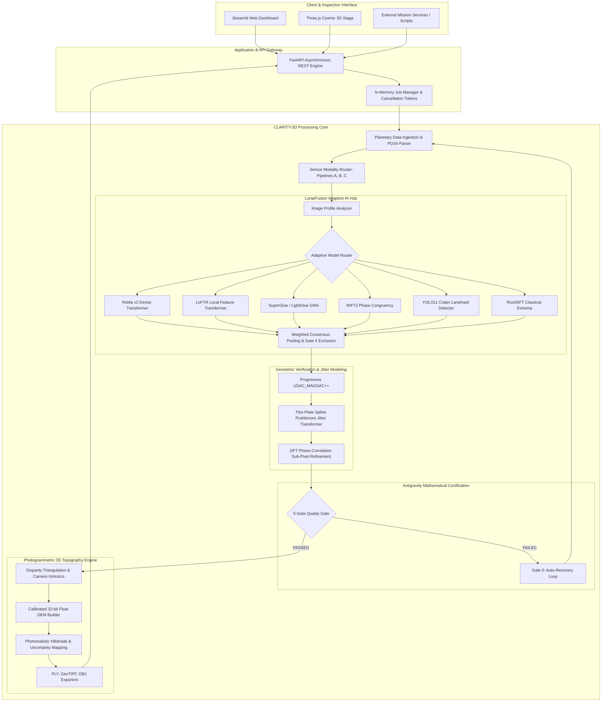

# PROJECT SYNOPSIS

## 1. Title of the Project
**CLARITY-3D: Automated Multi-Modal Co-Registration and Photogrammetric 3D Terrain Synthesis Suite for Heterogeneous Lunar Orbital Remote Sensing**

---

## 2. Introduction
Lunar exploration and planetary surface characterization require the precise integration of multi-temporal, multi-sensor orbital datasets. Recent missions, including the Indian Space Research Organisation's (ISRO) Chandrayaan-1 and Chandrayaan-2 orbiters, NASA's Lunar Reconnaissance Orbiter (LRO), and JAXA's SELENE (Kaguya), have acquired unprecedented volumes of high-resolution optical, hyperspectral, and Synthetic Aperture Radar (SAR) imagery. Key optical instruments such as Chandrayaan-2's Optical High Resolution Camera (OHRC, $0.25\text{ m/pixel}$) and Terrain Mapping Camera-2 (TMC-2, $5.0\text{ m/pixel}$), operating alongside LRO's Narrow Angle Camera (LROC-NAC), offer sub-meter structural visibility of the lunar surface.

However, exploiting these heterogeneous image archives for cartographic mapping, landing site hazard evaluation, and resource exploration requires sub-pixel spatial co-registration and precise photogrammetric 3D elevation reconstruction. Co-registration across orbital passes is severely impeded by extreme variations in solar illumination geometry, opposite-direction shadow casting, low dynamic range in Permanently Shadowed Regions (PSRs), spacecraft attitude oscillations (pushbroom jitter), and profound cross-sensor radiometric differences (e.g., optical reflectance versus SAR backscatter). 

This project proposes **CLARITY-3D**, a microservice-architected, deep-learning-augmented planetary processing suite. By combining sensor-aware radiometric normalization, an adaptive multi-engine AI matching hub (*LunarFusion*), non-rigid Thin-Plate Spline (TPS) transformation, strict mathematical anti-overfitting quality gates, and photogrammetric stereo Digital Elevation Model (DEM) generation, CLARITY-3D establishes an automated end-to-end framework for mission-grade lunar spatial analysis.

---

## 3. Problem Statement
Accurate alignment and elevation synthesis of lunar orbital datasets face critical technical and algorithmic bottlenecks that cause traditional photogrammetric tools to fail:

1. **Illumination and Shadow Inversion:** Traditional keypoint detectors (SIFT, SURF, ORB) rely on monotonic local pixel gradients. When solar azimuth angles shift between orbital passes, crater rim shadows invert completely, rendering classical feature descriptors mutually uncorrelated and producing over $80\%$ outlier matches.
2. **Cross-Modal Radiometric Divergence:** Aligning optical imagery (OHRC/NAC) with hyperspectral bands (IIRS) or SAR backscatter (DFSAR) cannot be achieved via standard intensity correlation. Existing tools lack specialized structural invariance pipelines capable of bridging multi-modal representations without severe keypoint loss.
3. **Spacecraft Pushbroom Sensor Jitter:** Linear array (pushbroom) pushbroom sensors operating on orbital platforms experience high-frequency platform attitude vibrations. This introduces non-linear, line-dependent geometric distortions that violate rigid planar homography or affine assumptions.
4. **The "4-Point Trap" and Match Clustering (Silent Failures):** Standard RANSAC pipelines frequently suffer from mathematical overfitting—selecting 4 closely clustered tie-points on a single crater rim that yield a misleading $0.000\text{ px}$ residual while leaving the remaining $85\%$ of the frame misaligned. Current planetary software lacks rigorous mathematical quality gates to reject these false-positive registrations automatically.
5. **Fragmented 3D Reconstruction Workflows:** Existing planetary workflows (e.g., USGS ISIS3 and NASA Ames Stereo Pipeline) require complex, multi-step manual script chaining across specialized Unix command-line utilities, lacking an integrated, real-time microservice interface for automated validation and interactive 3D terrain inspection.

---

## 4. Objectives
The planned technical objectives for the CLARITY-3D system are:

- **Objective 1 (Modular Architecture & Ingestion):** Design and construct a high-throughput, containerized processing architecture with a FastAPI REST backend and an interactive UI that ingests standard planetary data formats (PDS4 XML, raw `.img` planetary rasters, and multi-band GeoTIFFs).
- **Objective 2 (Sensor-Aware Preprocessing Pipelines):** Develop and implement three modality-tailored preprocessing pipelines: Pipeline A for optical pairs (CLAHE, crater inversion, morphological dilation, PCA enhancement), Pipeline B for hyperspectral-to-panchromatic pairs (Wallis filtering, CDF histogram matching, logarithmic tone mapping), and Pipeline C for SAR-to-optical cross-modal pairs (Adaptive Lee speckle filtering, log-ratio normalization, phase congruency structural extraction).
- **Objective 3 (Adaptive Multi-Engine AI Matching Hub):** Develop *LunarFusion*, an adaptive ensemble feature matching engine that dynamically diagnoses terrain texture, shadow fraction, and histogram distance in $\le 50\text{ ms}$, routing to optimal deep learning matchers (RoMa v2, LoFTR, SuperGlue, LightGlue), physical landmark anchors (YOLO11 Lunar Crater Detector), and radiation-invariant descriptors (RIFT2, ASIFT, RootSIFT).
- **Objective 4 (Non-Rigid Rectification & Mathematical Quality Gating):** Implement a Progressive USAC_MAGSAC++ estimator coupled with a Thin-Plate Spline (TPS) jitter transformer and warp-rectified sub-pixel phase correlation. Enforce strict mathematical quality gates (Gate 1: 4-Point Trap rejection, Gate 2: Minimum 15 inliers, Gate 3: $\ge 15\%$ spatial grid coverage, Gate 4: Zero-hallucination weight nullification, Gate 5: Autonomous self-healing recovery loop).
- **Objective 5 (Photogrammetric 3D DEM & Digital Twin Synthesis):** Implement calibrated photogrammetric stereo depth triangulation using physical sensor camera models (TMC-2, OHRC) to synthesize metric Digital Elevation Models (DEM), 3D elevation uncertainty maps, photorealistic hillshades, and full-resolution Stanford PLY and Wavefront OBJ meshes for interactive 3D rendering.

---

## 5. Scope of the Project

### 5.1 Technical Boundaries
The system is scoped to process dual-frame and multi-frame orbital imagery acquired over the lunar surface. It targets co-registration and 3D surface synthesis between homogeneous pairs (e.g., OHRC-to-OHRC, TMC-2 stereo forward/nadir/after strips) and heterogeneous cross-sensor pairs (OHRC-to-NAC, IIRS-to-WAC, DFSAR-to-SELENE).

### 5.2 Target End-Users and Primary Use Cases
- **Planetary Cartographers & Space Agencies (ISRO, NASA):** Automated generation of seamless, orthorectified regional lunar base maps.
- **Mission Flight Dynamics & Landing Site Engineers:** Safe landing site characterization, hazard slope detection, and crater morphology quantification for lander/rover missions (e.g., Chandrayaan-3 and Artemis sites).
- **Planetary Science Researchers:** Multi-temporal crater degradation tracking, regolith space weathering analysis, and permanently shadowed water-ice volatile exploration.

### 5.3 Major Planned Functional Modules
1. **Planetary Data Ingestion Engine:** Robust raster decimation, PDS4 XML label parser, and SPICE kernel ephemeris reader.
2. **Sensor Modality Preprocessing Router:** Automated execution of Pipelines A, B, and C with Hapke/Wallis photometric normalization.
3. **LunarFusion Adaptive AI Matcher:** Dynamic multi-scale matching hub with confidence-weighted consensus pooling and fault isolation.
4. **Geometric Transformation & Sub-Pixel Refinement:** Progressive MAGSAC++, non-rigid TPS spacecraft jitter compensation, and 2D discrete Fourier transform (DFT) phase correlation refinement.
5. **Antigravity Mathematical Certification Authority:** Five-tier quality gate assessing RMSE, spatial entropy, condition numbers, and out-of-sample holdout validation.
6. **3D Stereo Topography Synthesizer:** Disparity triangulation to metric elevation, slope hazard classification, and uncertainty variance propagation.
7. **Delivery & Inspection Interfaces:** FastAPI asynchronous REST API service, interactive Streamlit workspace, sub-pixel checkerboard seam continuity inspector, and Three.js 3D Cosmic Stage viewer.

### 5.4 Technical Assumptions and Deliberate Limitations
- **Geographic Overlap:** Input image pairs are assumed to share a minimum coarse geographical intersection ($\ge 8\%$ spatial overlap) verified by orbital coordinates or preliminary feature prechecks.
- **Ephemeris Data:** Where full SPICE BSP/TI kernels are not available locally, the system falls back to PDS4 XML label solar azimuth and elevation metadata.
- **Bundle Adjustment Scope:** Multi-view observation networks are formatted for NASA ASP `parallel_bundle_adjust`, but full multi-strip global block adjustment ($>4$ strips) is deferred to a future scale-out phase; the primary scope focuses on pairwise and dual-stereo 4-image quad fusion.

---

## 6. Literature Survey / Existing System

### 6.1 Overview of Existing Systems
Current planetary image processing and stereo reconstruction rely on institutional software packages developed over several decades:
- **USGS ISIS3 (Integrated Software for Imagers and Spectrometers):** The industry standard for planetary cartography, providing sensor calibration, radiometric normalization, and map projection.
- **NASA Ames Stereo Pipeline (ASP):** An open-source automated stereogrammetry suite widely used to generate DEMs from planetary stereo imagery using classical correlators and bundle adjustment.
- **Classical Computer Vision Pipelines (OpenCV / SIFT / ASIFT / AKAZE):** Traditional feature detection and matching frameworks that identify scale-space local extrema and match descriptors using Euclidean distance ratio tests.

### 6.2 Technical Limitations and Bottlenecks
| Feature / Characteristic | Existing Approaches (ISIS3 / NASA ASP / SIFT) | Proposed CLARITY-3D Suite |
| :--- | :--- | :--- |
| **Illumination Tolerance** | Fails when solar phase angles differ by $>20^\circ$; crater rim shadows produce invalid correspondences. | Deep transformer and GNN backbones (LoFTR, SuperGlue) learn topological context; invariant to shadow reversal. |
| **Cross-Modal SAR-to-Optical** | Incompatible; classical edge and corner detectors fail on SAR speckle noise. | Implements Pipeline C (Adaptive Lee filtering, log-ratio normalization, and RIFT2 phase congruency matching). |
| **Overfitting Prevention** | Standard RANSAC accepts any 4 inliers satisfying minimal residual, causing silent registration failures. | Strict 5-gate Antigravity validation; rejects $\le 4$ inliers, enforces $\ge 15$ MVR floor, and tests spatial entropy. |
| **Spacecraft Jitter Compensation** | Limited to affine or global projective homography; cannot model non-linear orbital scanline vibrations. | Pushbroom Jitter Transformer utilizing bi-harmonic Thin-Plate Splines (TPS) to model non-rigid orbital distortions. |
| **Operational Workflow** | Complex command-line tool chaining requiring deep scripting expertise; lacks interactive inspection. | Unified web dashboard (Streamlit + Three.js) and asynchronous FastAPI microservice with live telemetry. |

---

## 7. Proposed System and Methodology

### 7.1 Core Solution Concept
CLARITY-3D proposes an end-to-end automated processing pipeline where raw planetary imagery is ingested, radiometrically normalized, matched via an ensemble of deep neural networks and classical algorithms, verified against rigorous mathematical gates, corrected for non-rigid sensor jitter, and triangulated into metric 3D digital elevation models.

### 7.2 High-Level Architectural Data Flow
The proposed workflow operates across distinct sequential layers:

1. **Ingestion & Precheck:** The ingestion layer accepts PDS4 `.img`, `.tif`, `.png`, or `.jpg` formats. GeoTIFFs are read out-of-core via `rasterio` decimation. An initial structural similarity and spatial overlap precheck prevents expensive processing on non-overlapping pairs.
2. **Sensor-Aware Preprocessing Router:** Depending on sensor types, the system executes:
   - *Pipeline A (Optical OHRC $\leftrightarrow$ NAC):* 8-bit normalization, CLAHE contrast expansion, image inversion (converting dark crater floors to bright anchor points), morphological dilation, and PCA variance enhancement.
   - *Pipeline B (Hyperspectral IIRS $\leftrightarrow$ WAC):* Band selection, cumulative distribution function (CDF) histogram matching, multi-scale Wallis filtering, and logarithmic tone compression.
   - *Pipeline C (SAR DFSAR $\leftrightarrow$ Optical SELENE):* Adaptive Lee speckle suppression, radiometric log-ratio backscatter normalization, and multi-orientation Phase Congruency structural edge extraction.
3. **LunarFusion Adaptive AI Matching Hub:** The preprocessed imagery enters an image profile analyzer ($\le 50\text{ ms}$) evaluating texture variance, shadow fraction, and histogram distance. The adaptive router dispatches candidate models:
   - Deep Transformers: RoMa v2 (dense transformer foundation model), LoFTR (detector-free local feature transformer).
   - Graph Neural Networks: SuperGlue / LightGlue (Sinkhorn optimal transport matching on learned keypoints).
   - Landmark Matching: YOLO11 Lunar Crater Detector (identifying macroscopic crater rims and matching invariant neighborhood topology).
   - Frequency-Domain & Classical: RIFT2 (radiation-invariant phase congruency), ASIFT (affine perspective tilt simulation), RootSIFT (Hellinger kernel normalization).
4. **Geometric Rectification & Quality Certification:**
   - Surviving raw matches are filtered using Progressive USAC_MAGSAC++ (50,000 maximum iterations, $0.999$ confidence).
   - Non-linear orbital distortions are modeled using Thin-Plate Splines (TPS).
   - Keypoints undergo sub-pixel refinement via DFT phase correlation.
   - The result is audited against the 5 Antigravity Quality Gates. Registrations failing Gates 1–3 trigger the autonomous recovery loop (Gate 5) upscaling resolution to $4096\text{ px}$ and engaging CPU deterministic fallback.
5. **Photogrammetric 3D Topography Synthesizer:**
   - Verified disparity maps are projected through calibrated camera intrinsic models ($Z = \frac{f \cdot B}{d \cdot \text{pitch}}$).
   - Digital elevation models are post-processed with photorealistic hillshading, directional photoclinometry (Shape-from-Shading), and elevation uncertainty mapping.
   - 3D products are exported as 32-bit floating point GeoTIFFs, colored Stanford PLY point clouds, and Wavefront OBJ meshes.

### 7.3 Architectural System Flowchart

---

## 8. System Requirements

### 8.1 Hardware Requirements
- **Processor (CPU):** Minimum: 8-Core Intel Xeon / Core i7 or AMD Ryzen 7 (2.8 GHz base clock). Recommended: Apple Silicon M-Series (M1/M2/M3/M4 Pro/Max) or 16-Core AMD EPYC/Ryzen 9 for multithreaded pyramid matching and SGBM stereo correlation.
- **Graphics Processing Unit (GPU):** Minimum: NVIDIA GeForce RTX 3060 (6 GB VRAM) with CUDA support or Apple Silicon Unified Memory GPU. Recommended: NVIDIA RTX 4090 / A100 (16 GB+ VRAM) for high-batch RoMa v2 dense transformer and LoFTR inference.
- **Random Access Memory (RAM):** Minimum: $16\text{ GB}$. Recommended: $32\text{ GB} - 64\text{ GB}$ to accommodate out-of-core decimation of multi-gigabyte uncompressed PDS4 `.img` files and $4096\text{ px}$ multi-scale pyramids.
- **Storage:** Minimum: $50\text{ GB}$ high-speed NVMe Solid State Drive (SSD) for local scratch space, model weights (`romav2.0.1.pt`, `loftr_outdoor.ckpt`, `yolo11n.pt`), and GeoTIFF raster caching.
- **Network Interface:** Standard 1 Gbps Ethernet/Wi-Fi for microservice API client-server communication and orbital tile data streaming.

### 8.2 Software Requirements
- **Operating System:** Ubuntu 22.04 LTS (x86_64) with NVIDIA Container Toolkit, or macOS 13.0+ (Ventura/Sonoma/Sequoia on Apple Silicon arm64).
- **Programming Language:** Python 3.10.x to 3.14.x.
- **Core Frameworks & Runtimes:**
  - Deep Learning: `PyTorch >= 2.0.0`, `torchvision`, `kornia >= 0.7.0`.
  - Computer Vision & Geometry: `opencv-python >= 4.8.0`, `opencv-contrib-python`, `scikit-image`, `scipy`, `numpy >= 1.24.0`.
  - Geospatial & Planetary Data: `rasterio >= 1.3.0`, `pds4_tools >= 1.3`, `spiceypy >= 5.0.0`, `imagecodecs`.
  - Deep Matcher Engines: `romav2`, `romatch`, `ultralytics >= 8.3.0` (YOLO11).
  - Web & Microservice Frameworks: `fastapi >= 0.100.0`, `uvicorn >= 0.22.0`, `python-multipart`, `streamlit >= 1.28.0`.
  - Visualization & Reporting: `plotly >= 5.15.0`, `matplotlib >= 3.7.0`, `reportlab >= 4.0.0`, `Three.js (r128)`.
- **Database & State Management:** In-memory job state registry with thread-safe locks (`threading.Lock`), JSON-persisted execution history registry (`registration_history.json`).
- **Development Tools & Infrastructure:** Docker / Docker Compose, Git version control, Pytest test framework (`pytest-anyio`), Visual Studio Code / JetBrains PyCharm.

---

## 9. Expected Outcome

### 9.1 Concrete Deliverables
1. **Core Processing Engine:** A fully modularized, reproducible Python package (`src/`) containing the planetary reader, sensor modality router, deep matching hub, outlier rejection, quality certification, and 3D DEM builder.
2. **Production-Ready REST Microservice:** A containerized FastAPI service (`api/main.py`) exposing asynchronous job management, status polling, cancellation, and artifact delivery endpoints.
3. **Interactive Mission Dashboard:** A responsive Streamlit web application (`ui/app.py`) providing live telemetry, interactive match inspection, sub-pixel checkerboard seam continuity verification, and the WebGL-powered Three.js 3D Cosmic Stage viewer.
4. **Automated Quality Certification Suite:** A deterministic evaluation framework generating automated PDF audit reports and JSON provenance certificates detailing RMSE, spatial entropy, inlier ratios, and error budget decomposition.
5. **Comprehensive Verification Suite:** A suite of $\ge 160$ automated unit, integration, and regression tests validating accuracy, robustness against the 4-point trap, and mathematical quality gates.

### 9.2 Performance and Functional Benefits
- **Sub-Pixel Registration Precision:** Attainment of sub-pixel co-registration accuracy ($< 0.5\text{ px}$ RMSE on high-resolution optical pairs, $< 1.0\text{ px}$ on complex cross-sensor pairs).
- **Zero Silent Failures:** Guaranteed elimination of false-positive registrations through strict enforcement of the 5 Antigravity quality gates.
- **Illumination Resilience:** Reliable tie-point extraction across lunar orbital pairs with phase angle disparities exceeding $45^\circ$, where traditional tools fail completely.
- **Metric 3D Elevation Accuracy:** Generation of photogrammetrically consistent Digital Elevation Models with vertical uncertainty maps directly supporting hazard-free landing ellipse evaluation.

---

## 10. Applications
1. **Autonomous Lunar Landing Site Hazard Certification:** Automated analysis of slope distributions, crater rim boulders, and topographic relief to certify landing ellipses for robotic landers and crewed exploration missions.
2. **Permanently Shadowed Region (PSR) Water-Ice Prospecting:** Precise co-registration of ultra-sensitive secondary-illumination optical imagery (e.g., ShadowCam / OHRC long-exposure) with SAR polarimetric backscatter (DFSAR) to map volatile deposits in deep polar craters.
3. **High-Resolution Regional Lunar Cartography:** Automated, seamless co-registration and orthorectification of massive historical orbital datasets (Chandrayaan-1/2, LRO, Kaguya) into geometrically unified regional base maps.
4. **Lunar Surface Digital Twins for Rover Path Planning:** Generation of high-density 3D meshes (PLY/OBJ) imported into robotic simulation environments (e.g., ROS, Gazebo, Blender) to plan traverse routes and communication lines-of-sight for planetary rovers.

---

## 11. Conclusion
The proposed **CLARITY-3D** software suite addresses the critical limitations of existing planetary image registration and stereo elevation extraction systems. By combining specialized radiometric preprocessing pipelines (Pipelines A, B, and C) with an adaptive multi-engine AI matching hub (*LunarFusion*), non-rigid Thin-Plate Spline spacecraft jitter correction, and the 5-Gate Antigravity mathematical certification authority, the project establishes a robust solution to the challenges of solar illumination variance, opposite shadow casting, and cross-sensor disparity. 

The software framework is designed to bridge advanced academic computer vision research with operational space mission requirements. Delivered as an asynchronous REST microservice paired with an interactive 3D digital twin dashboard, CLARITY-3D will provide space agencies, planetary researchers, and mission engineers with an automated, zero-hallucination, sub-pixel accurate foundation for scientific discovery and safe lunar surface exploration.

---

## 12. References
1. Sarlin, P. E., DeTone, D., Malisiewicz, T., & Rabinovich, A. (2020). *SuperGlue: Learning Feature Matching with Graph Neural Networks*. In Proceedings of the IEEE/CVF Conference on Computer Vision and Pattern Recognition (CVPR), pp. 4938–4947.
2. Sun, J., Shen, Z., Wang, Y., Bao, H., & Zhou, X. (2021). *LoFTR: Detector-Free Local Feature Matching with Transformers*. In Proceedings of the IEEE/CVF Conference on Computer Vision and Pattern Recognition (CVPR), pp. 8922–8931.
3. Li, J., Hu, Q., & Ai, M. (2020). *RIFT: Multi-Modal Image Matching Based on Radiation-Variation Insensitive Feature Transform*. IEEE Transactions on Image Processing (TIP), 29, pp. 3296–3310.
4. Beyer, R. A., Alexandrov, O., & McMichael, S. (2018). *The Ames Stereo Pipeline: NASA's Open Source Software for Deriving and Processing Terrain Data*. Earth and Space Science, 5(9), pp. 537–548.
5. Indian Space Research Organisation (ISRO). (2025). *Comparative Analysis of Image Registration Algorithms for Chandrayaan-2 Lunar Datasets*. Planetary Data System Technical Reports, ISRO Cartographic Mission Studies.
